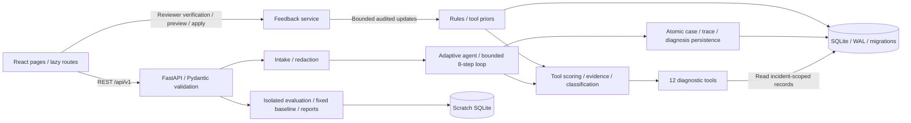

# EV Charging Customer Support and Escalation System

## Run a fresh GitHub checkout (Windows Git Bash)

The GitHub repository contains the full application source, tests, lockfiles, configuration, examples and intentional research reports. Local SQLite ticket data, credentials, logs, environments and installed packages are excluded. API startup creates the database automatically; the optional seed command supplies synthetic session logs for demonstrations.

```bash
git clone https://github.com/rashmim-arjun/EV_Charging_Support_Ticket_System.git
cd EV_Charging_Support_Ticket_System
py -3.13 -m venv .venv
./.venv/Scripts/python.exe -m pip install -r ev_backend/requirements-lock.txt
# Optional: create synthetic charging-session records for the demo examples.
./.venv/Scripts/python.exe ev_backend/scripts/seed_database.py --seed 42 --per-template 10
(cd ev_frontend && npm.cmd ci)
```

From the cloned repository root, start the backend in terminal 1:

```bash
./.venv/Scripts/python.exe -m uvicorn app.main:app --app-dir ev_backend --host 127.0.0.1 --port 8000 --reload
```

In terminal 2, change into the same clone and start the frontend:

```bash
cd ev_frontend
npm.cmd run dev -- --host localhost --strictPort
```

Open **http://localhost:5173**. No external AI API key is required. To inspect all component logs, open **Communication monitoring**, select **Successful charging**, and generate a session. Existing-folder commands and detailed configuration follow below.

A local academic customer-support application built with React, FastAPI, Python and SQLite. Its main workflow is **customer complaint → support ticket → correlate component logs → investigate origin → evidence-supported diagnosis → classification and priority → internal ownership/escalation → verified resolution and closure**. Existing case IDs are ticket IDs; the simulator and communication dashboard support this workflow. A bounded rule-based agent, an extended cross-component agent and reviewer-verified learning assist staff. No external LLM, paid API, live charger integration or external dispatch is required.

The **Communication monitoring** page extends this workflow with coordinated app, CSMS, charger/connector, vehicle/BMS, payment and network simulation. It reconstructs a charging session, detects communication anomalies and diagnoses root causes using correlated event evidence. Both agents and the original case/review/import workflows remain available. Events are OCPP/ISO 15118 inspired; this is not a protocol implementation or compliance claim.

Demo charging records are **synthetic**. Imported reviews and manually entered complaints retain their `data_origin`. Names of apps identify configurable demo contexts; these results do not describe those companies' real services.

## Combined completion package (4 November 2026)

This edition merges the stronger completed implementation with the original project's SQLite data (250 existing cases/tickets), fixes evidence validation and human escalation lifecycle consistency, and includes new regression tests and reproducible synthetic evaluation outputs. Review the full eight-point objective checklist and verification limits in **`docs/PROJECT_COMPARISON_AND_VERIFICATION.md`**. The shipped `ev_diagnosis.db` already contains original demonstration cases; reseeding is optional, not required to view those records. The database remains a local support-ticket store; no external assignment notification is sent.

## Requirements

- Python 3.11+; verified on Python **3.13.5**.
- Node.js **22.12+** or a supported newer LTS; verified on **24.14.1**. The patched Vite/Vitest versions require a current Node runtime.
- npm and internet access for the first dependency installation.
- For browser tests: Microsoft Edge on Windows, or Playwright Chromium on other platforms.

## Install and run on Windows (PowerShell)

Run these commands from the repository root. No activation script is required.
These blocks are specifically for **PowerShell**. If your prompt contains `MINGW64` or `$`, use the **Git Bash on Windows** section below; PowerShell backslashes and `$env:NAME` assignments are not Bash syntax.

```powershell
py -3.13 -m venv .venv
.\.venv\Scripts\python.exe -m pip install -r ev_backend\requirements-lock.txt
.\.venv\Scripts\python.exe ev_backend\scripts\seed_database.py --seed 42 --per-template 10
```

Start the API in the first terminal:

```powershell
.\.venv\Scripts\python.exe -m uvicorn app.main:app --app-dir ev_backend --host 127.0.0.1 --port 8000 --reload
```

Start the frontend in a second terminal:

```powershell
cd ev_frontend
npm.cmd ci
npm.cmd run dev -- --host localhost --strictPort
```

Open **http://localhost:5173**. API documentation: **http://127.0.0.1:8000/docs**. Health: **http://127.0.0.1:8000/api/v1/health**.

If `python` opens the Microsoft Store or reports access denied, use the Python launcher (`py`) to create the environment and then its explicit interpreter path as above. Use `npm.cmd` if PowerShell blocks `npm.ps1`.

The frontend defaults to `/api/v1` on its own origin. Vite dev and preview proxy `/api` to `http://127.0.0.1:8000`, avoiding localhost IPv4/IPv6 differences and cross-origin browser requests. `.env` is optional. To change the proxy target, copy `ev_frontend/.env.example` to `.env`, set `EV_API_TARGET` to the backend origin (without `/api/v1`), and restart Vite. `VITE_API_BASE` overrides the browser API base and must include `/api/v1`; remove an old absolute value to use the proxy. `VITE_*` settings are public, so never store keys there.

Direct API access permits `http://localhost:5173` and `http://127.0.0.1:5173`. To use another frontend origin, export `EV_CORS_ORIGINS` as a comma-separated list or edit `ev_backend/app/config/settings.json`. Backend `.env` files are opt-in: pass `--env-file ev_backend/.env` to Uvicorn. No external AI API or key is required: the existing local diagnostic agents inspect SQLite observations. When evidence is absent, the result is inconclusive with evidence requests, not an invented successful diagnosis. For static production hosting, configure the host/reverse proxy to forward `/api` to FastAPI, or build with an explicit `VITE_API_BASE` and allow that frontend origin in backend CORS settings.

## Git Bash on Windows (MINGW64)

Git Bash uses forward slashes, but a Windows virtual environment still has `Scripts/python.exe`, not `bin/python`. Always change to `ev_frontend` successfully before running npm. Its package name should be `ev-diagnosis-frontend`; a catering package name means npm is running in the wrong directory.

For an existing setup, paste this entire block into Git Bash from any directory. It runs in a subshell and stops on the first failure, so an unsuccessful directory change cannot accidentally run npm against a parent project:

```bash
(
  set -e
  cd "$HOME/Downloads/EV_Charging_Support_Ticket_System_Final/DP-main"
  ./.venv/Scripts/python.exe -m pytest ev_backend/tests -q -o addopts= --tb=short
  ./.venv/Scripts/python.exe ev_backend/scripts/run_evaluation.py --seed 42 --per-template 8 --check-reproducibility
  cd ev_frontend
  npm.cmd ci
  npm.cmd test
  npm.cmd run build
  npm.cmd audit --audit-level=low
  E2E_PRODUCTION=1 npm.cmd run test:e2e
)
```

Stop manually running servers on ports 8000 and 5173 before browser tests. The normal `.venv` environment is used above. To use the optional verification environment instead, replace both Python paths with `./.venv-clean/Scripts/python.exe` and run browser tests with `E2E_CLEAN=1 E2E_PRODUCTION=1 npm.cmd run test:e2e`.

For a first-time Git Bash setup, paste this block. Dependencies belong in **DP-main/.venv**, not the outer folder's `.venv`. No environment activation is needed:

```bash
(
  set -e
  cd "$HOME/Downloads/EV_Charging_Support_Ticket_System_Final/DP-main"
  py -3.13 -m venv .venv
  ./.venv/Scripts/python.exe -m pip install -r ev_backend/requirements-lock.txt
  cd ev_frontend
  npm.cmd ci
)
```

To start the app normally, use two Git Bash terminals:

```bash
# Terminal 1:
cd "$HOME/Downloads/EV_Charging_Support_Ticket_System_Final/DP-main" && ./.venv/Scripts/python.exe -m uvicorn app.main:app --app-dir ev_backend --host 127.0.0.1 --port 8000 --reload

# Terminal 2:
cd "$HOME/Downloads/EV_Charging_Support_Ticket_System_Final/DP-main/ev_frontend" && npm.cmd run dev -- --host localhost --strictPort
```

Open http://localhost:5173. Bash environment assignment is `NAME=value command` (or `export NAME=value`); do not paste PowerShell `$env:NAME = 'value'` into Bash.

Startup applies the schema repair automatically. Existing data needs no reseeding. To explicitly back up and migrate an existing database first, run from `DP-main`:

```bash
./.venv/Scripts/python.exe ev_backend/scripts/check_local_database.py --repair
```

This uses SQLite's backup API and retains a timestamped `.db.backup-*` file. To inspect without changing anything, omit `--repair`. For a completely fresh database only, the optional `seed_database.py --seed 42 --per-template 10` command supplies synthetic logs for the first quick sample. Manual complaints without logs still receive an inconclusive diagnosis and recommended next steps.

## Linux/macOS equivalents

```bash
python3 -m venv .venv
.venv/bin/python -m pip install -r ev_backend/requirements-lock.txt
.venv/bin/python ev_backend/scripts/seed_database.py --seed 42 --per-template 10
.venv/bin/python -m uvicorn app.main:app --app-dir ev_backend --host 127.0.0.1 --port 8000 --reload
# Second terminal:
cd ev_frontend
npm ci
npm run dev -- --host localhost --strictPort
```

These commands are provided for portability; the final full-stack browser run was verified on Windows, not on Linux/macOS.

## Database lifecycle

`ev_diagnosis.db` is generated next to `ev_backend/` and is ignored by Git. API startup creates/migrates schema version **6**, syncs the existing demo apps plus general EV support, adds missing seed rules without overwriting learned weights, and initializes three demo reviewers. It does not automatically fabricate charging sessions. Version 4 adds communication observations and separate annotations. Version 5 adds delivery-attempt identity, one support profile per existing case, audited ticket history and versioned checks/evidence/resolutions. Version 6 repairs shipped v5 databases missing `diagnosis_version` columns and restores the per-diagnosis resolution index. Migrations commit schema changes and their version marker together. Existing cases are backfilled conservatively into triage, preserving their IDs, diagnoses and feedback. Generation is additive/idempotent; the legacy demo reset preserves communication sessions.

The seed command above creates 250 labelled synthetic cases plus their sessions, events, payments and status snapshots. Seeded cases initially show **open / not run**; submit the first quick sample to generate and persist a diagnosis. Repeating the same seed and template count is idempotent. Changing the template count for an existing seed requires a fresh database or a deliberate demo reset to prevent mixed datasets.

```powershell
# A separate, reproducible demo database:
.\.venv\Scripts\python.exe ev_backend\scripts\seed_database.py --db .tmp\review-demo.db --seed 42 --per-template 10
$env:EV_DB_PATH = (Join-Path $PWD '.tmp\review-demo.db')
.\.venv\Scripts\python.exe -m uvicorn app.main:app --app-dir ev_backend --port 8000
```

`EV_DB_PATH` overrides the API database path. `--db` affects only that seed invocation; set `EV_DB_PATH` when starting the API to use it. To reset disposable synthetic records before feedback has been recorded, use `seed_database.py --reset`. Reset refuses to remove data when verified resolutions exist; choose a new database path to preserve that audit history. Back up a database before an upgrade. Evaluations and browser tests use separate scratch databases and never reset the user's database.

## Academic demonstration

1. Open **New complaint**, expand **Demo examples**, select **Session never started (matches seeded logs)** and click **Run diagnosis**. The sample uses Tata Power EZ Charge / `SSN-042-0001` from seed 42.
2. Inspect **Diagnosis**, **Evidence** and **Agent trace**. The trace records candidate scores, selection reasons, actual tool results and belief changes. Missing data and failures are explicit.
3. Open **Verify & learn**, select `rev-001`, verify **Session fails to start**, enter the corrective action and submit. Preview and apply learning. A second application is a no-op.
4. Visit **Knowledge & learning** to inspect updated weights, tool priors and observation counts. Revert the newest change or roll back changes after an anchor. Older changes to the same target must be reverted in reverse order. Inactive proposed rules can be activated through an audited action.
5. Filter **Cases** by status/category/app/origin and open the resolved case. The dashboard's accuracy uses reviewer-verified resolutions, with a small-sample warning.
6. Open **Evaluation** and run seed 42 with 8 cases/template. It evaluates 200 cases, compares the adaptive agent with a fixed-order baseline under the same eight-check budget, and shows calibration, class metrics and confusion matrices.
7. Import `examples/reviews.csv` or `examples/reviews.json` on **Review import**. Inspect imported/skipped counts, error messages and stored redacted text. Reviews are stored for analysis; importing them does not fabricate charging logs or automatically turn them into verified diagnoses.

CSV requires `text,data_origin`; JSON accepts an array or `{ "reviews": [...] }`. Reviews without `app_id` are stored under general EV Charging Support. Existing imports with an explicit valid `app_id` remain supported. The review page shows all providers together, with an Origin filter. Origins: `simulated`, `manual_test`, `real_public_review`. Uploads must be UTF-8 and at most 2 MB. Invalid rows are counted as skipped; parse/database errors roll back the whole import. Both text columns are stored redacted. Redaction is best-effort.

## Tests and build

```powershell
# Repository root:
.\.venv\Scripts\python.exe -m pytest ev_backend\tests -q -o addopts=
.\.venv\Scripts\python.exe -m pip check
.\.venv\Scripts\python.exe ev_backend\scripts\run_evaluation.py --seed 42 --per-template 8 --check-reproducibility
.\.venv\Scripts\python.exe ev_backend\scripts\evaluate_communication.py --seed 42 --per-template 4 --install-calibration --check-reproducibility

# ev_frontend/:
npm.cmd test
npm.cmd run build
npm.cmd audit
```

For end-to-end browser tests, first stop manually running servers on ports **8000 and 5173**, then run from `ev_frontend/`:

```powershell
npm.cmd run test:e2e
```

The runner starts both servers, seeds a disposable database, and exercises the complete workflow at 1440×1000 and 390×844. Windows defaults to installed Edge. To choose another installed browser, set `PLAYWRIGHT_CHANNEL=chrome`. On Linux/macOS run `npx playwright install chromium` first; Chromium is the default there. The backend test server expects the root `.venv` from setup. Screenshots and failure traces go to ignored `test-results/`. The tests use no external accounts.

To inspect a failure: `npx playwright show-trace test-results/<failure-directory>/trace.zip`. To preview the production build: `npm.cmd run preview -- --host localhost --port 5173 --strictPort` with the backend running.

For isolated production browser tests while your normal servers remain running, use this **Git Bash** block from `ev_frontend/` (ports 8010 and 5174 must be free):

```bash
npm.cmd run build -- --outDir .tmp/communication-preview
E2E_ISOLATED=1 E2E_PRODUCTION=1 npm.cmd run test:e2e
```

Final submission verification and exact commands are recorded in [FINAL_SUBMISSION.md](docs/FINAL_SUBMISSION.md). Earlier verification records describe earlier revisions. Historical benchmark reports remain unchanged; final reruns are stored separately under `ev_backend/reports/submission/`.

## Main support-ticket demonstration

The customer form requires only a short complaint (10–500 characters); date/time starts at the browser's current local time and remains editable. Four issue starters fill editable complaints of about 125–140 characters. The app selector has been removed: the backend infers the provider from an exact session reference, or records the case under general **EV Charging Support**. Existing explicit `app_id` API requests still work. Optional session lookup fills the recorded station, and stored station IDs appear as suggestions; demo stations are labelled. There is no station coordinate catalog, so GPS matching is unavailable and no location permission is requested. Error/payment/user-reference/data-origin controls remain under **Additional details**, and demo samples are collapsed separately. The API still accepts existing longer complaint payloads for compatibility.

1. Open **New complaint**, enter the customer complaint and related session ID, then select **Save ticket before investigation**. The ticket is persisted in state `new` before diagnostic work starts. **Run diagnosis** preserves the existing automatic option, also saving the complaint first; a failed investigation returns the retained ticket ID instead of losing the complaint.
2. In **Support ticket management**, select **Investigate ticket**. A linked communication session uses the cross-component agent; original session records use the existing adaptive agent. Complaint context does not replace available log evidence.
3. Inspect the diagnosis, supporting event IDs/timestamps and **Inspect correlated session logs**. Missing and contradictory observations can produce inconclusive results and requests for evidence. Multiple corroborated mechanisms remain visible without inventing a unique primary cause.
4. Review priority, assigned owner and supporting teams. Rules are configured in `ev_backend/app/config/support_policy.json`. Unlocalized cases go to triage. Safety observations or reported hazards can require urgent review before exact fault attribution.
5. Change team, supporting teams, priority or lifecycle state with an operator identity and reason. Choose `escalated` for a local escalation. The audit preserves before/after decisions; stale updates are rejected. **No email, notification or external service ticket is sent.**
6. Use **Record verified resolution / Verify & learn**. Known verified fault categories can update the existing bounded learning system. `No fault established` and `Inconclusive after human review` can close administrative investigations without training on a fabricated fault label. Resolve before closing.
7. Close the ticket, or reopen and investigate new evidence. The same ID is retained with a new diagnosis version, separate evidence/check traces and a new reviewer resolution. Original resolutions and learning audit remain available.

Ticket states: `new`, `investigating`, `awaiting_evidence`, `assigned`, `escalated`, `resolved`, `closed`. Existing case status fields remain for API compatibility. **Cases** is the support queue, with ticket-state/priority filters and ownership displays. Communication monitoring offers **Open support ticket for this session**, preserving the selected session in intake.

## Research and submission commands

From the repository root in **Git Bash on Windows**:

```bash
./.venv/Scripts/python.exe ev_backend/scripts/run_evaluation.py --seed 42 --per-template 8 --output ev_backend/reports/submission/legacy --check-reproducibility
./.venv/Scripts/python.exe ev_backend/scripts/evaluate_communication.py --seed 42 --per-template 4 --output ev_backend/reports/submission/communication --check-reproducibility
./.venv/Scripts/python.exe ev_backend/scripts/run_research.py --development-only --seed 20261104 --repeats 2 --output ev_backend/reports/submission/development --check-reproducibility
./.venv/Scripts/python.exe ev_backend/scripts/run_research.py --seed 20261104 --repeats 2 --output ev_backend/reports/submission/research --check-reproducibility
./.venv/Scripts/python.exe ev_backend/scripts/generate_challenge.py --seed 20261104 --repeats 2 --output .tmp/support-challenge.json
./.venv/Scripts/python.exe ev_backend/scripts/package_submission.py
```

The new challenge has **32 train, 32 validation and 46 test sessions** from separately declared configurations, including unseen fault combinations, real retries, observation loss, ambiguous/conflicting evidence and near-concurrent distinct sessions. Its paired ablation uses the same complaints, cases, partitions and exact-root/set targets in text-only and text-plus-observation arms. Independently authored support expectations evaluate classification, priority, routing and escalation. The text baseline is a small train-only naive Bayes model; it is not a strong language-model baseline. See [research methodology, results and limitations](docs/RESEARCH_SUBMISSION.md).

Final scores are synthetic simulation results. Models/rules/configuration hashes and validation calibration are frozen before each test scoring run. The first frozen challenge report is retained separately; after first exposure, ticket intake persistence was hardened without tuning diagnostic rules, thresholds or labels. The final repeat is an exposed-test regression, not a fresh blind external holdout. The simulator, ontology and authored symptoms remain shared sources of bias.

The clean ZIP is `submission/EV_Support_Submission.zip`, generated without the working database, environments, installed dependencies, caches, logs, browser traces or frontend builds. Source, lockfiles, tests, required configuration, intentional reports and a SHA256 file manifest are retained. Extract it into a new directory and use the setup commands above. The database is regenerated by `seed_database.py` and `generate_communication.py`; no runtime DB is needed in the archive.

Agents receive an allowlisted, read-only SQLite observation snapshot. Annotation tables/columns, scenario IDs, generation settings and split assignments are absent; SQL write/attachment operations are denied. Verified historical resolutions remain legitimate learning inputs. This is an enforced application boundary, not protection against hostile Python code with filesystem access.

## Communication simulation demonstration

Start both servers using the setup above and open **http://localhost:5173/communication**. Restart an existing backend after this upgrade to register the new API routes and migrate the database.

1. Generate a test-split dataset with seed 42 and one session per scenario (12 sessions), or choose one fault family. Generation does not replace existing cases or reviewer history.
2. Select a session. Inspect historical component health, chronological logs, structured payloads and the message flow. Filter by component or correlation ID to trace one request.
3. Open detected failures and select an event reference to highlight its timeline evidence. Health describes the selected session's observations, not a live connection.
4. Run root-cause diagnosis. The result separates evidence strength from validation-calibrated confidence, names the responsible component and links supporting events. Missing or conflicting evidence can produce **inconclusive**.
5. For a faulty/inconclusive case, follow the case link to the existing reviewer workflow. Verified outcomes update existing rule weights and tool priorities through audited, reversible learning. A healthy session records its result without inventing a failure case.
6. Run the communication comparison. This evaluates fresh scratch data; it does not train against your selected session or alter your working database.

Contradictory message contents, request/reply identities, transport outcomes or authoritative facts block a unique diagnosis: the result is inconclusive, confidence is absent, and the conflicting event references remain inspectable. Distinct accepted retries and newer status revisions remain valid. See [the contradictory-message fix and regression evidence](docs/CONTRADICTORY_MESSAGE_FIX.md). After upgrading, rerun diagnosis on previously analyzed sessions to replace the displayed latest result; historical results are retained.

From the repository root, these **Git Bash** commands generate persistent sessions, export annotated data and regenerate the benchmark:

```bash
./.venv/Scripts/python.exe ev_backend/scripts/generate_communication.py --seed 42 --split test --per-template 1
./.venv/Scripts/python.exe ev_backend/scripts/generate_communication.py --config examples/communication_config.json --export .tmp/communication-custom.json
./.venv/Scripts/python.exe ev_backend/scripts/evaluate_communication.py --seed 42 --per-template 4 --install-calibration --check-reproducibility
```

Use `--db .tmp/communication-demo.db` to generate a separate database, then set `EV_DB_PATH` when starting the API to use it. Configuration supports `delay`, `drop`, `duplicate`, `stale` and `timeout` injections. The example delays payment capture in an otherwise healthy physical session. Annotated exports contain evaluation labels; the public session API and agent observations exclude them. Unreachable injections are reported, and overlapping custom mechanisms are conservatively marked outside the standard single-fault benchmark. See [architecture, schema, API and methodology](docs/COMMUNICATION_PLATFORM.md).

The measured seed-42 communication benchmark generates **144 sessions: 48 training, 48 validation, 48 test**, with separate scenario templates and fault configurations. Each test family has four examples.

| Test metric | Fixed baseline | Current adaptive | Multi-component |
|---|---:|---:|---:|
| Exact root-cause accuracy (44 observable sessions) | 18.18% | 18.18% | 100% |
| Decision accuracy (48, including abstentions) | 25% | 25% | 100% |
| Broad category accuracy | 33.33% | 33.33% | 100% |
| Macro-F1 (ten fault mechanisms) | 0.1000 | 0.1000 | 1.0000 |
| Communication failure detection | 75% | 75% | 100% |
| Fault component localization | 10% | 10% | 100% |
| Mean checks/session | 8.000 | 6.833 | 5.083 |

These are **authored synthetic scenario results**, not evidence of 100% real-world accuracy. The new agent sees transport/component observations that the original agents cannot consume; legacy outputs also use broader labels, so ambiguous exact mechanisms remain unresolved. This compares capabilities, not just learning or tool scheduling. Holdout templates vary startup order, fault triggers, operations and configuration bands, but share the simulator and diagnostic ontology. Validation-only confidence fitting gives test ECE 0.041667 and Brier 0.001736 for the new agent; small samples and pooled probabilities limit interpretation. Full predictions, per-category precision/recall/F1/support, confusion matrices, split manifests and reproducibility evidence are in [the communication report](ev_backend/reports/communication_evaluation.md) and its adjacent JSON/CSV.

## Measured evaluation

The legacy fixture set, labels and denominators are preserved. Results below come from actual runs, not targets.

| Metric | Original adaptive report | Revised adaptive | Revised fixed baseline |
|---|---:|---:|---:|
| Accuracy | 53.0% | **91.0%** | 78.0% |
| Macro-F1 (12 causes) | 0.5255* | **0.9548** | 0.7214 |
| Correct abstention on inconclusive cases | 59.38% | 75.0% | 75.0% |
| Confident assertions on inconclusive cases | 40.62% | 25.0% | 25.0% |
| Mean checks/case | 5.37 | 4.83 | 7.60 |
| Persisted evidence traceability | Legacy check was vacuous | 100% | 100% |

\* Historical F1 omitted false positives on inconclusive cases. The revised scorer corrects this for both methods; historical F1 is not strictly comparable. The original reports are preserved in `docs/original-evaluation/`.

The independent synthetic calibration run uses seed **314159**, 20 variants/template (500 development cases). On seed-42 asserted diagnoses, heuristic ECE is **0.3817** and calibrated ECE is **0.0066** (Brier **0.0459**). All supported calibrated bins pool to the same 0.9452 probability on this development set: this is aggregate calibration, not proof of fine-grained ranking or real-world confidence. Abstentions have no asserted-root-cause probability.

The held-out learning experiment has **91% accuracy and 0.9637 macro-F1 both before and after feedback**, while checks fall **4.83 → 3.25**. This run verifies the learning mechanism and an efficiency gain; it does not demonstrate an accuracy gain. See [diagnosis findings and limitations](docs/DIAGNOSIS_FINDINGS.md).

Reports under `ev_backend/reports/` include Markdown, headline CSV, per-category CSV, JSON metrics/confusion matrices, full case outcomes and detailed incorrect-case traces. Regenerate them with the evaluation command above. Calibration can be deliberately refitted with `fit_calibration.py --seed 314159 --per-template 20`; it must use a different seed from the evaluation. Test runs do not refit it.

## Architecture



Code: `ev_backend/app/agent/` (policy/tools), `services/` (orchestration/learning/metrics), `routers/` and `schemas.py` (API contracts), `core/db.py` (schema), `evaluation/` (benchmark), `ev_frontend/src/pages/` (UI). See [verification evidence](docs/VERIFICATION.md) and [changed files](docs/CHANGES.md).

## Scope and remaining limitations

This is a functional local academic demo, not a validated production diagnosis service. Ten legacy fixtures have app/label or evidence/label inconsistencies, and eight payment-conflict fixtures lack independently verified capture evidence. They remain in the scored benchmark. Their case IDs and effects are documented in the generated dataset audit and findings.

The legacy rule set and generator share template families, calibration is synthetic, and its learning split is case-disjoint rather than template-disjoint. The new communication benchmark separately holds out templates/configurations, with the limitations described above. No real charging-network integration, production identity/authentication, independent expert-labelled test set or deployment is claimed. Reviewer IDs represent local demo identities, not authenticated users. The runtime database, local `.env`, caches, logs, build outputs and dependency directories are ignored; retain `.env.example`, lockfiles, source tests and intentional evaluation reports.
