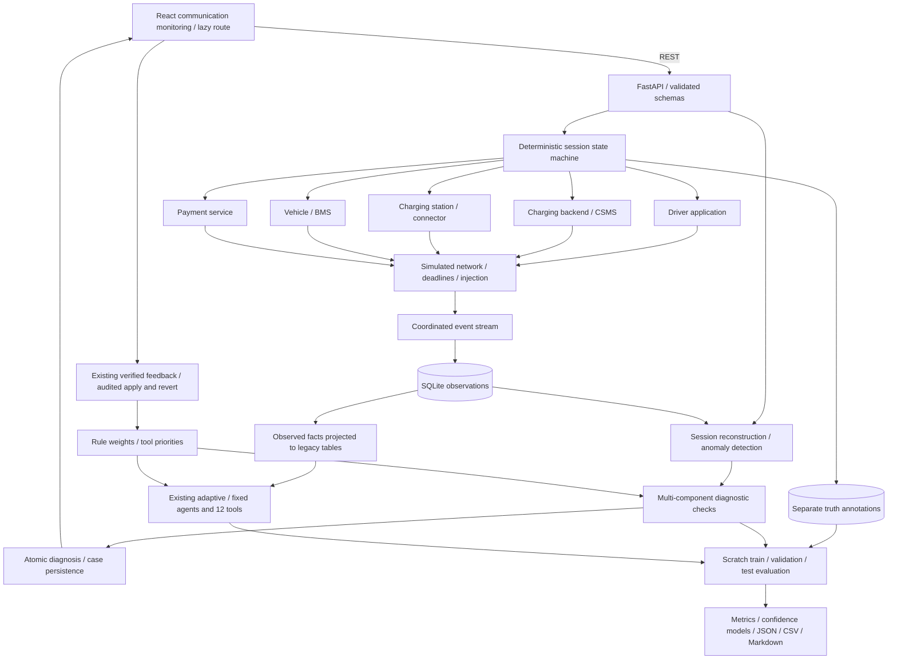

# Communication simulation and diagnosis

Implemented and locally verified on 2026-11-04. This extension preserves the original complaint agent, fixed baseline, case review, feedback learning, imports and benchmark. It simulates semantic exchanges inside one Python process; it does not communicate with real equipment.

## Architecture



Ground truth has no path into runtime diagnostic inputs. SQLite separates observations from evaluation annotations; this is a logical separation, not database access control against a malicious process.

## Session model

The causal model proceeds through discovery, connection, authorization, startup, energy delivery, metering, completion/interruption and reconciliation. Its states are idle, discovered, connected, authorized, charging, completed, stopped and failed. A failed handshake cannot silently advance to charging. A safety stop terminates energy delivery; a faulted connector is not published as available after unplugging.

There are eight actor types representing six ecosystem groups: app, CSMS, charger, connector, vehicle, BMS, payment and network. Each generated session has component IDs, a session ID and one root trace ID. Individual request/reply exchanges use correlation and message IDs. Identifiers are deterministic opaque digests and do not embed fault labels.

Messages include StatusNotification, Authorize, RequestStartTransaction, SetChargingProfile, TransactionEvent.Started/Ended, MeterValues, SessionSetupReq, ChargeParameterDiscoveryReq, BatteryStatusRequest, PowerDeliveryReq and PaymentHold/Capture. These deliberately simplified names mix protocol-inspired and application-specific operations. Responses use a normalized `.response` suffix.

Each send produces observable source, transport and receiver events as appropriate. Loss removes delivery and prevents the receiver action. Delays advance the event clock and can exceed a 3-second synthetic deadline. Duplicates retain message identity, create distinct event IDs and are ignored by an idempotent receiver. Timeouts distinguish a received command with an unresponsive controller from an undelivered command. Stale StatusNotification data can contradict actual connector occupancy.

Metering uses cumulative energy, elapsed time and power rather than independent random readings. Simulated battery capacity is 60 kWh; initial SOC, sample duration and charging power are bounded, with SOC derived from delivered energy. This is an illustrative energy model without electrochemical dynamics, AC/DC power conversion or thermal simulation. Invoice/payment events refer to that same session energy and tariff. Fault injections may deliberately violate the invoice relationship while preserving the physical meter evidence.

## Scenarios and configuration

The public taxonomy includes normal (`none`), controller timeout, BMS fault, authorization conflict, payment conflict, connector fault, network delay, network loss, network duplicate, stale availability, metering mismatch and inconclusive observations.

`examples/communication_config.json` is a runnable custom injection example. Configuration fields:

| Field | Meaning |
|---|---|
| seed | Deterministic dataset seed, 0 through 2147483647 |
| per_template | Sessions per selected split template, 1 through 20 |
| split | train, validation, test or all |
| scenarios | Optional subset of the twelve scenario names |
| injections | Up to five additional injection objects |
| injection.kind | delay, drop, duplicate, stale or timeout |
| injection.operation | Exact operation to target; stale requires StatusNotification |
| injection.delay_ms | 1 through 120000; relevant to delay |
| injection.copies | 1 through 3; additional duplicate deliveries |

Each injection targets the first matching operation. An operation never reached because of an earlier failure is reported as unapplied. Additional custom injections are exploratory and conservatively annotated outside the standard benchmark (`expected_label=inconclusive`); this label does not force the runtime agent to abstain if observations establish a unique cause. `root_causes` records mechanisms that actually fired, `root_cause` is their unique cause (or null for multiple mechanisms), and sub-deadline delays are not labeled as faults. A configured profile prevented by an earlier injection is not claimed as an observed physical cause. No scored test cases use custom injections.

From the repository root, in **Git Bash on Windows**:

```bash
./.venv/Scripts/python.exe ev_backend/scripts/generate_communication.py --db .tmp/communication-demo.db --seed 42 --split test --per-template 2
./.venv/Scripts/python.exe ev_backend/scripts/generate_communication.py --db .tmp/communication-demo.db --scenario vehicle_bms_fault --split validation --per-template 1
./.venv/Scripts/python.exe ev_backend/scripts/generate_communication.py --config examples/communication_config.json --db .tmp/communication-custom.db --export .tmp/communication-custom.json
```

Without `--db`, generation uses the normal project database. `--config` supplies the full request configuration instead of the seed/split/scenario CLI flags. `--export` includes annotations for offline research and must not be treated as unlabeled agent input. Repeating an identical configuration is idempotent. To serve a separate database in Git Bash:

```bash
EV_DB_PATH="$PWD/.tmp/communication-demo.db" ./.venv/Scripts/python.exe -m uvicorn app.main:app --app-dir ev_backend --host 127.0.0.1 --port 8000
```

## Observation and persistence contract

Every event has `event_id`, `session_id`, `trace_id`, `correlation_id`, optional `message_id` and `parent_event_id`, `component_id`, `component_type`, timezone-aware `timestamp`, monotonic `sequence`, `event_type`, `severity`, `status`, `message` and structured `payload`. The correlation layer sorts by timestamp/sequence and validates event identities and session/trace consistency.

Migration 004 adds communication_runs, communication_sessions, communication_events, communication_truth and communication_diagnoses. Event identity, ordering, indexes and foreign keys support idempotent persistence and trace lookup. The observation projection into original charging_sessions/events/payments/status tables allows legacy tools to inspect factual records without exposing root labels.

Annotations include physical root cause, expected diagnostic label, affected components, expected events, evidence event IDs, fault configuration, split/template, physical status and energy. Inconclusive templates simulate a physically normal lifecycle but retain only incomplete observations: they test justified abstention, not a fictional physical fault called inconclusive. Public session status is unknown when completion was not observed. Runtime diagnosis and component health use visible observations only.

## Correlation and diagnosis

Reconstruction groups message sends, network delivery and receives by message identity and exchanges by correlation ID. It detects dropped/missing deliveries, absent responses, excessive latency, duplicate deliveries, orphan receives, identity/clock/order conflicts, contradictory authorization/payment/availability claims, invalid state transitions and invoice/meter inconsistencies.

The new agent runs transport, controller, physical-safety, authorization, availability, billing and completion checks as relevant, bounded by eight checks. Existing learned priors order checks, and seeded `mc_...` evidence rules use the existing belief update and feedback machinery. Deactivated rules remain deactivated; generation never restores learned weights.

Message integrity is checked before transport fault attribution. A message ID cannot silently change payload, endpoints or correlation identity. Drops combined with delivery/receipt, incompatible replies, invalid reply contracts, and a rejected handshake followed by an unsupported successful outcome are explicit conflicts. Terminal authorization/payment facts, status revisions, invoices and meter samples are checked within their business context. Different requests and later revisions are not collapsed into a single contradictory fact. Conflicts block a root assertion even when an independent candidate fault exists; the evidence and candidate hypotheses remain visible with no root confidence. Component health becomes unknown with `conflicting_observations` for affected observation sources rather than asserting a network fault from contradictory records. A distinct accepted retry can reconcile a previous rejection. Full details and tested boundaries are in [CONTRADICTORY_MESSAGE_FIX.md](CONTRADICTORY_MESSAGE_FIX.md).

Supporting evidence contains actual event references and corroborating component sources. A BMS error plus delivered stop and charger state change supports a vehicle-side diagnosis. A sent message with a recorded network drop supports transport loss; a command received by the charger followed by its local watchdog supports controller failure. Normal requires an observed complete lifecycle, required communications, metering and reconciliation. Multiple independent candidate mechanisms, conflicting provenance or missing evidence can yield an explicit inconclusive result with unresolved questions and no asserted-root probability.

Diagnosis persistence and the linked legacy failure case commit atomically. Healthy results have no artificial failure case. Reviewer verification continues to learn the existing broad failure categories; it does not train a new neural root-cause classifier. Apply/revert/idempotency behavior is retained.

## API and frontend

All routes below are under `/api/v1/communication`:

| Method and path | Purpose |
|---|---|
| GET /templates | Scenario catalog, split templates and simulation scope |
| POST /generate | Generate and persist; IDs, counts and unapplied injection warnings |
| GET /sessions | Paginated observations; optional run_id, page and page_size |
| GET /sessions/{session_id} | Events, reconstructed flows, anomalies, component health and latest diagnosis |
| POST /sessions/{session_id}/diagnose | Correlated diagnosis with supporting event IDs and optional legacy case link |
| GET /evaluation | Most recent comparison summary, or available=false |
| POST /evaluation | Run isolated comparison; seed and per_template (1 through 15) |

Typed generation/list/detail responses omit truth annotations. Invalid configuration is 422; missing sessions are 404; concurrent evaluations are rejected with 409 within a server process; an unreadable saved report gives 503. The evaluation lock is process-local, matching this single-process local demo.

The lazy-loaded `/communication` page includes generation/injection controls, session paging, historical health/connection cards, searchable chronological logs with structured payloads, an SVG message flow, communication failures/conflicts and root-cause evidence links. Selecting a message filters by correlation; selecting an evidence reference highlights its timeline event. Session switches reset the selected view. Loading, retry, error and empty states are explicit. Wide tables/flows scroll within their cards on mobile.

## Evaluation methodology

Run from the repository root in **Git Bash**:

```bash
./.venv/Scripts/python.exe ev_backend/scripts/evaluate_communication.py --seed 42 --per-template 4 --install-calibration --check-reproducibility
```

The command creates a fresh scratch SQLite database and generates 36 templates across three partitions. Each partition has twelve families, four sessions each for this command: 48 train, 48 validation and 48 test. Template IDs and complete fault-configuration hashes are checked for overlap before scoring. A deterministic seed alone is not treated as sufficient separation.

| Variant | Train | Validation | Test |
|---|---|---|---|
| Startup | Remote-first | Early vehicle setup | Local authorization-first / reordered vehicle setup |
| Delayed operation | Authorize | ChargeParameterDiscoveryReq | TransactionEvent.Ended |
| Lost operation | RequestStartTransaction | Authorize | ChargeParameterDiscoveryReq |
| Duplicated operation | TransactionEvent.Started | MeterValues | PaymentCapture |
| Controller timeout | RequestStartTransaction | ConnectorLock | SetChargingProfile |
| BMS trigger | HV interlock before power | Overtemperature at first sample | Isolation fault at second sample |
| Connector trigger | Latch before power | Contactor at first sample | Temperature at second sample |
| Meter samples | 3 | 4 | 5 |
| Incomplete observations | Intake only | Limited app/backend observations | Connection/authentication plus an unconfirmed send |

Other conflict scenarios vary values, diagnostic state and split-specific configuration bands. These variants share causal infrastructure and ontology; their independence is limited to authored templates/configurations.

The fixed and current adaptive methods are frozen before training changes. They receive the existing table projection and the same generic complaint. The new agent is trained through forty reviewer-verified train outcomes (sixty audited knowledge changes in the seed-42 run). Validation fits monotonic probability bins with Beta smoothing separately for each method; test outcomes never fit weights or probabilities. `--install-calibration` installs only the validation model and metadata for this simulator version. Omitting it leaves the runtime calibration artifact unchanged. The API comparison does not install calibration or mutate the working knowledge database.

Metrics include exact-root accuracy on 44 observable sessions, decision/category accuracy on all 48, per-label precision/recall/F1/support and confusion matrices, ten-fault macro-F1, assertion ECE/Brier, mean checks, communication/transport detection, false positives and fault-only component localization. Abstentions have no asserted-root probability. Communication detection includes the three network mechanisms plus missing controller responses; transport detection includes only the three network mechanisms. Checks batch different amounts of data across methods, so counts are not a CPU cost comparison.

The legacy agents return broad categories. Categories corresponding to multiple exact mechanisms remain `unresolved:<category>` rather than using labels to choose a mechanism. Category accuracy is therefore also reported. The original 200-case legacy benchmark remains separate and retains 91% adaptive accuracy. The new legacy scores cannot be used to claim a regression on that original benchmark.

Actual communication outcomes are in `ev_backend/reports/communication_evaluation.md`, JSON and category CSV. JSON contains every test prediction, evidence, confidence, split manifest and learned calibration model. Reproducibility is verified by two independent scratch runs comparing all reported metrics and probability models.

## Limitations and future extensions

The observed 100% new-agent synthetic test score demonstrates the ten encoded fault mechanisms and justified normal/abstention cases. Generator and diagnosis rules were authored together; independent hardware logs and expert annotations are needed to assess generalization. Four test examples per family do not establish population performance. The richer event access, different taxonomy and grouped checks limit comparisons with the legacy agents. Calibration largely pools predictions and is not a per-case real-world probability guarantee.

Transport is simulated event scheduling, not sockets or a real unreliable network. There are no OCPP JSON schemas/conformance tests, WebSockets, station certificates, ISO 15118 EXI encoding, PLC negotiation, Plug & Charge PKI or actual payment processing. Fault injection supports exploratory combinations, but the benchmark is deliberately single-mechanism. The model does not cover shared charging-site load balancing, concurrent actor contention, clock synchronization algorithms or battery electrochemistry.

The application remains a local academic demo with demo reviewer identities. Authentication, multi-tenant authorization, real device adapters, externally validated datasets, concurrent distributed ingestion and deployment are future work, not verified features.

Protocol concepts were checked against primary references: [Open Charge Alliance OCPP 2.0.1 overview](https://openchargealliance.org/wp-content/uploads/2024/01/new_in_ocpp_201-v10.pdf), [OCPP 2.x minimal footprint](https://openchargealliance.org/wp-content/uploads/2025/03/ocpp_2_x_minimal_footprint-v14.pdf), [ISO 15118-2 overview](https://www.iso.org/standard/55366.html) and [CharIN FAQ](https://www.charin.global/faq-section/). These references motivate terminology, not a certification claim.
